# Lab 4 — Generative Models with PyTorch: AE, VAE and GAN

---

## 1. Objective

Get familiar with PyTorch by building and training three families of generative models:

| Part | Model | Dataset |
|---|---|---|
| 1 | Auto-Encoder (AE) and Variational Auto-Encoder (VAE) | MNIST |
| 2 | GAN (DCGAN) | [Abstract Art Gallery](https://www.kaggle.com/datasets/bryanb/abstract-art-gallery) (2 872 images) |

All experiments were run in a single notebook on **Google Colab (Tesla T4 GPU)**, PyTorch 2.14, with a fixed seed (42).

## 2. Repository content

```
├── Lab4_AE_VAE_GAN.ipynb      # full notebook, executed, with all outputs
├── README.md                  # this report
└── outputs/
    ├── figures/               # every figure used below (PNG)
    ├── models/                # ae.pt, vae.pt, generator.pt, discriminator.pt
    └── results.json           # all key numbers of the lab
```

**To reproduce:** open the notebook on Colab or Kaggle, select a GPU runtime and *Run all* (≈ 25 min). MNIST is downloaded through `torchvision`; the Abstract Art dataset is read from `/kaggle/input` or downloaded with `kagglehub`.

---

## 3. Part 1 — AE and VAE on MNIST

### 3.1 Data
60 000 training images were split into **55 000 train / 5 000 validation**; the 10 000 **test** images are used only for the final evaluation. Pixels are scaled to [0, 1].

### 3.2 Architectures

Both models are fully-connected and share the same layer sizes (≈ 1.08 M parameters each).

| | Encoder | Latent | Decoder |
|---|---|---|---|
| **AE** | 784 → 512 → 256 → *d* (ReLU) | *d* | *d* → 256 → 512 → 784 (ReLU, Sigmoid) |
| **VAE** | 784 → 512 → 256 → two heads **μ**, **log σ²** (size *d*) | *z = μ + σ ⊙ ε*, ε ~ N(0, I) | same as AE |

* **AE loss:** Binary Cross-Entropy (sum over pixels, mean over the batch).
* **VAE loss:** negative ELBO = BCE reconstruction + β · KL(q(z|x) ‖ N(0, I)), with β = 1 and the closed-form KL.
* **Optimiser:** Adam, batch size 128.

### 3.3 Hyper-parameter selection
A grid search over the latent dimension *d* ∈ {8, 16, 32} and the learning rate ∈ {1e-3, 3e-4} was run (5 epochs per configuration), selecting on the **validation** loss.

| AE (val. BCE) | lr = 1e-3 | lr = 3e-4 |  | VAE (val. −ELBO) | lr = 1e-3 | lr = 3e-4 |
|---|---|---|---|---|---|---|
| d = 8  | 91.38 | 99.34 | | d = 8  | 113.14 | 120.56 |
| d = 16 | 76.22 | 86.12 | | d = 16 | **109.45** | 117.48 |
| d = 32 | **70.85** | 83.49 | | d = 32 | 110.92 | 121.17 |

**Best hyper-parameters (final training: 30 epochs, best-validation checkpoint kept):**

| Model | Latent dim | Learning rate | Batch | Optimiser | Best epoch |
|---|---|---|---|---|---|
| AE  | **32** | **1e-3** | 128 | Adam | 27 |
| VAE | **16** | **1e-3** | 128 | Adam | 29 |

### 3.4 Evaluation

**Training curves** (loss, reconstruction term, KL divergence): see `outputs/figures/p1_training_curves.png` and `p1_ae_vs_vae_recon.png`.

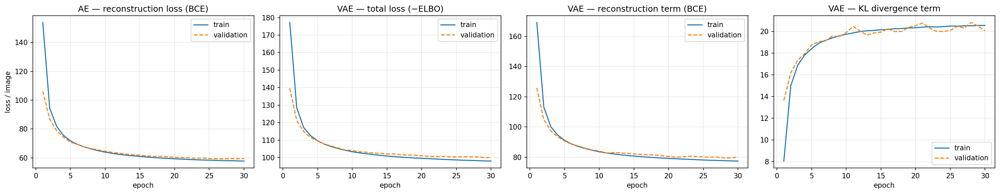

**Test-set results**

| Model | Latent dim | Recon. BCE ↓ | KL | Total loss | MSE / pixel ↓ |
|---|---|---|---|---|---|
| AE  | 32 | **58.73** | – | 58.73 | **0.0047** |
| VAE | 16 | 78.86 | 20.49 | 99.35 | 0.0128 |

**Reconstructions** (row 1: original, row 2: AE, row 3: VAE):

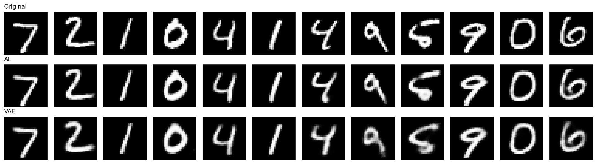

**Generation from the prior** — decoding random z ~ N(0, I):

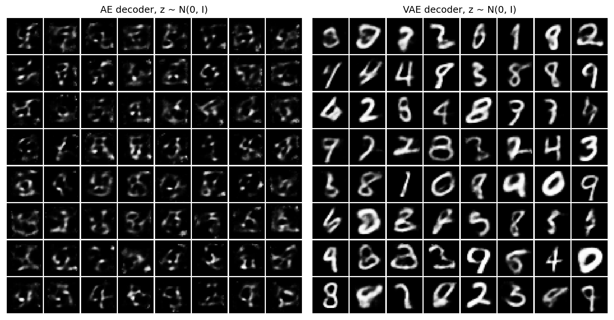

**Other analyses** (figures in `outputs/figures/`): latent interpolation (`p1_interpolation.png`) and KL per latent dimension (`p1_vae_kl_per_dim.png`) — **12 of the 16** VAE latent dimensions are active (mean KL > 0.1 nat).

### 3.5 Latent space

**t-SNE of the latent codes** (5 000 test digits; VAE uses the posterior mean μ):

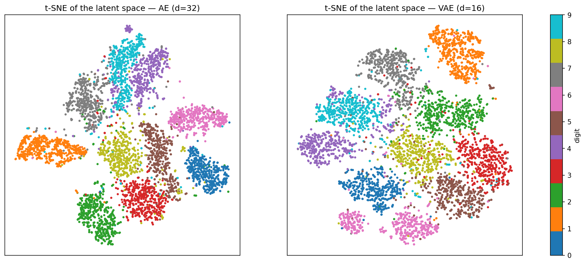

**Direct 2-D latent space** (dedicated models with *d* = 2) and the decoded latent grid:

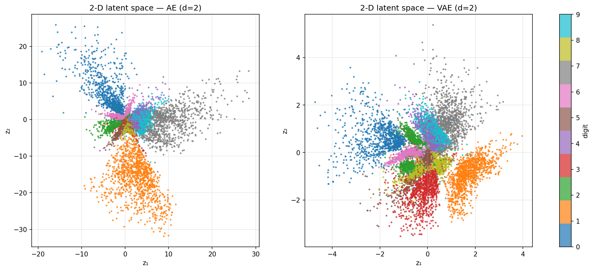
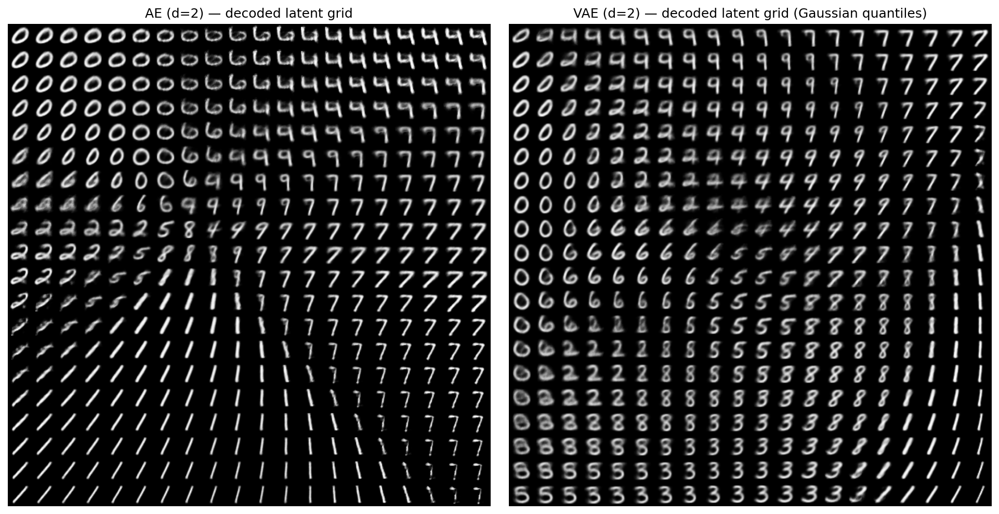

### 3.6 Conclusions of Part 1

1. **Reconstruction.** The AE reconstructs clearly better than the VAE (BCE 58.7 vs 78.9; MSE 0.0047 vs 0.0128) even though it has a larger latent code (32 vs 16). This is expected: the AE optimises only the reconstruction, whereas the VAE trades part of it for a regularised latent space. The reconstructions confirm it — the VAE outputs are slightly blurrier.
2. **KL divergence.** The VAE KL term rises quickly in the first epochs (13.6 → ≈ 20 nats) and then stabilises around 20 nats on validation and test: the encoder starts to carry information, then reaches a balance with the reconstruction term. Only 12 / 16 dimensions are really used, the others collapse to the prior.
3. **Generation.** This is the decisive difference. Decoding random noise through the VAE produces recognisable (if imperfect) digits, while the AE produces only unstructured strokes: the AE latent space has no prior, so random codes fall into regions the decoder never learned. **The AE is a compressor, not a generative model; the VAE is.**
4. **Latent space.** In t-SNE both models separate the ten classes well (the AE clusters are even a bit tighter). In the 2-D latent plots, however, the AE codes are spread over a very large, unbounded range (about −20 to 30 on z₁ and −30 to 20 on z₂), with many classes piled up near the origin, whereas the VAE codes are compact, centred on 0 and mostly within ±4 — i.e. they match the N(0, I) prior, which is what makes sampling possible.
5. **Hyper-parameters.** The larger learning rate (1e-3) was best for every configuration within the short search budget. A larger latent dimension keeps improving the AE (91 → 76 → 71), while the VAE saturates: *d* = 16 was better than *d* = 32 because extra dimensions are not used.

---

## 4. Part 2 — GAN on the Abstract Art Gallery

### 4.1 Data and pre-processing
2 872 images (none corrupted) are resized (shorter side to 64 px), centre-cropped to **64 × 64**, scaled to **[−1, 1]** and randomly flipped horizontally. They are cached in memory (44 batches of 64 per epoch).

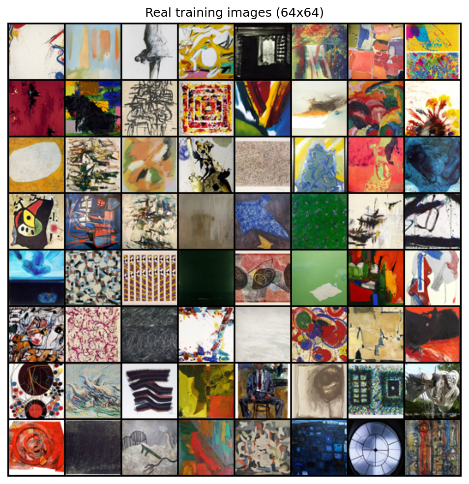

### 4.2 DCGAN architecture

* **Generator** (3.58 M parameters): z ∈ ℝ¹⁰⁰ → ConvTranspose blocks (4 → 8 → 16 → 32 → 64 px) with BatchNorm + ReLU, `Tanh` output.
* **Discriminator** (2.77 M parameters): 4 strided Conv blocks (64 → 4 px) with BatchNorm + LeakyReLU(0.2), one output logit.
* **Loss:** `BCEWithLogitsLoss`; non-saturating generator loss; one-sided label smoothing (real label = 0.9).
* **Initialisation:** N(0, 0.02) for the convolutions, N(1, 0.02) for BatchNorm.
* **Optimisers:** Adam (lr = 2e-4, β₁ = 0.5, β₂ = 0.999) for both networks; batch size 64; **200 epochs** (≈ 12 min on the T4).

### 4.3 Training and evaluation

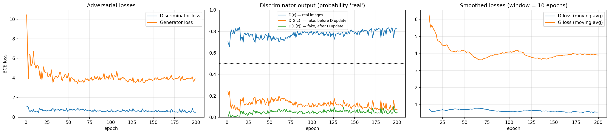

| Epoch | L_D | L_G | D(x) | D(G(z)) after D-update |
|---|---|---|---|---|
| 1 | 1.204 | 11.05 | 0.690 | 0.002 |
| 50 | 0.726 | 3.85 | 0.734 | 0.049 |
| 100 | 0.673 | 4.11 | 0.759 | 0.059 |
| 150 | 0.834 | 3.97 | 0.744 | 0.087 |
| 200 | 0.479 | 4.03 | 0.840 | 0.041 |

> A GAN has **no KL-divergence term** (it implicitly minimises a Jensen–Shannon divergence at the optimum of D), and its adversarial losses are not a measure of image quality. They were therefore complemented with the discriminator outputs, visual inspection and the Fréchet Inception Distance (FID).

**Progress of the generator** on a fixed noise batch (epochs 1 → 200):

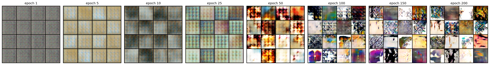

### 4.4 Generated data vs. original data

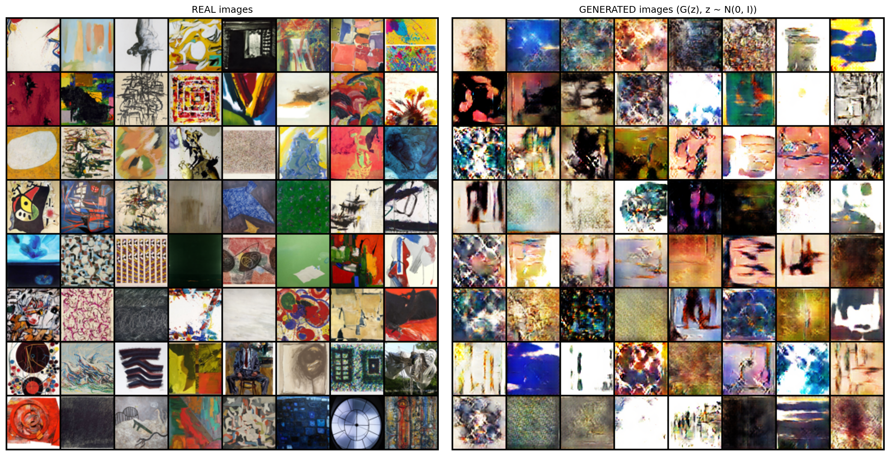

**Pixel statistics** (values in [0, 1]):

| Channel | Real mean | Generated mean | Real std | Generated std |
|---|---|---|---|---|
| R | 0.580 | 0.629 | 0.287 | 0.297 |
| G | 0.524 | 0.583 | 0.273 | 0.285 |
| B | 0.473 | 0.515 | 0.275 | 0.298 |

**FID (Inception-v3 features, 2 872 real vs 2 872 generated images):**

| Comparison | FID |
|---|---|
| Real vs real (two random halves) — best achievable reference | 41.89 |
| **Real vs generated** | **81.98** |
| Real vs random noise — worst-case reference | 314.52 |

**Memorisation check** — each generated image (top row) is shown with its nearest real image in pixel space (bottom row); the L2 distances are large (30.6 – 69.5) and the pairs are visually different, so the generator is **not copying** the training set:

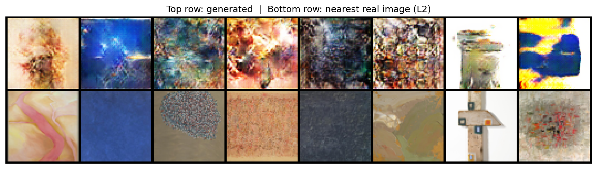

Latent interpolations, colour histograms: `p2_latent_interpolation.png`, `p2_pixel_histograms.png`.

### 4.5 Conclusions of Part 2

1. **Training dynamics.** After a violent start (L_G = 11 at epoch 1, the discriminator wins immediately), training settles: L_G stays around 4 and L_D between 0.5 and 0.9, with D(x) ≈ 0.7–0.84 and D(G(z)) ≈ 0.04–0.09 for the rest of the run. No collapse or divergence occurred. At the end the discriminator is slightly stronger than the generator (D(x) = 0.84, D(G(z)) = 0.04), a sign that more regularisation or augmentation could help.
2. **Visual quality.** The generator reproduces the global look of the dataset — colour palettes, large coloured areas, brush-stroke-like textures, white or grey backgrounds — and produces varied images. The details remain less coherent and sharp than the originals (cracked or noisy textures, local artefacts), which is typical of a DCGAN at 64 × 64 trained on fewer than 3 000 images; the generated images also tend to be slightly brighter than the real ones (mean intensity +0.04 to +0.06).
3. **Quantitative quality.** FID = 82 lies between the real-vs-real reference (42) and the noise reference (315), much closer to the former: the generated distribution is clearly learned but not indistinguishable from the real one. (With so few images, FID is biased upward, so it should be read relatively to these two references.)
4. **Generalisation.** The nearest-neighbour test shows that generated images are new compositions, not memorised training images.
5. **Possible improvements.** Spectral normalisation or WGAN-GP, differentiable augmentation (DiffAugment/ADA), higher resolution with progressive growing or StyleGAN, longer training.

---

## 5. Personal synthesis

* **PyTorch.** I learned to structure a deep-learning project with `nn.Module`, custom `Dataset` / `DataLoader`, generic training and evaluation loops, GPU usage, checkpointing (best-validation weights) and reproducibility (seeds).
* **AE vs VAE.** An auto-encoder is excellent for compression and reconstruction (lowest error) but its latent space is unstructured, so it cannot generate new data. The VAE adds a probabilistic encoder, the re-parameterisation trick and a KL regulariser: reconstructions become a bit blurrier, but the latent space becomes continuous and close to N(0, I), which allows sampling and interpolation. The VAE loss is a trade-off between reconstruction and KL, and some latent dimensions can collapse (12/16 active here). Hyper-parameter choice must use a validation set, not the test set.
* **GANs.** Adversarial training is a game between two networks, so the losses oscillate and are not an indicator of quality; one has to follow D(x) / D(G(z)), look at the images and use a metric such as FID, with reference values. DCGAN design rules (strided convolutions, BatchNorm, Adam β₁ = 0.5, label smoothing) are important for stability. A GAN gives sharper and more diverse images than a VAE but is harder to train and to evaluate, and has no KL/likelihood to monitor.
* **Overall.** The three families answer the same question — learning to generate data — in different ways: explicit compression (AE), explicit probabilistic latent model with an ELBO (VAE), and implicit distribution learning through a game (GAN).

---

## 6. References

* Kingma & Welling, *Auto-Encoding Variational Bayes*, ICLR 2014.
* Goodfellow et al., *Generative Adversarial Nets*, NeurIPS 2014.
* Radford, Metz & Chintala, *Unsupervised Representation Learning with Deep Convolutional GANs*, ICLR 2016.
* Heusel et al., *GANs Trained by a Two Time-Scale Update Rule Converge to a Local Nash Equilibrium* (FID), NeurIPS 2017.
* LeCun et al., MNIST database of handwritten digits.
